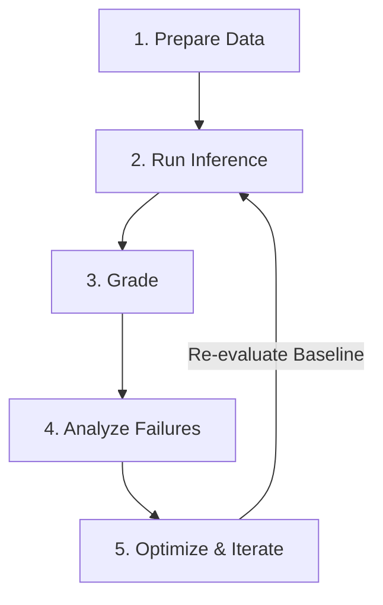

# Agent Quality Flywheel & Evaluation Methodology (`doc/eval.md`)

This document outlines the evaluation framework for Project Benjamin's ADK (Agent Development Kit) multi-agent SRE system, based on the **Agent Quality Flywheel** principles published on the [Google Developers Blog](https://developers.googleblog.com/driving-the-agent-quality-flywheel-from-your-coding-agent/).

---

## 🔁 The 5-Stage Agent Quality Flywheel

Rather than relying on informal "vibe-checks" after prompt changes, Benjamin enforces an automated, repeatable evaluation loop across 5 stages:



1. **Prepare Data**:
   - Synthesize test scenarios via `agents-cli eval dataset synthesize` or extract historical OpenTelemetry (OTel) traces from real GCP incident investigations.
   - Structured JSON configs stored in `eval/configs/*.eval.json` and `eval/scenarios/*.eval.json`.

2. **Run Inference**:
   - Execute ADK SRE agents (`commander`, `ops`, `logistics`, `planning`, `comms`) over test cases to generate multi-turn conversation traces.

3. **Grade**:
   - Score traces using adaptive AutoRaters (`multi_turn_task_success`, `multi_turn_trajectory_quality`) or custom categorical rubrics (`sre_root_cause_accuracy`, `risk_assessment_correctness`).
   - Decoupled scoring via Gemini Enterprise Agent Platform GenAI Evaluation Service ensures optimizers never grade their own work.

4. **Analyze Failures**:
   - Extract rubric verdicts to pinpoint exact step failures (e.g. agent stored correct internal state but echoed stale value in response).
   - Perform Automatic Loss Analysis across failure clusters.

5. **Optimize & Iterate**:
   - Apply targeted prompt or routing fixes, re-run grading, and compare metric deltas against baseline scores.

---

## 🛠️ Running Local Evaluations (`just eval`)

Run both single-agent isolation evaluations and end-to-end incident integration scenarios with a single command:

```bash
just eval
```

### Evaluation Architecture

- **Single Agent Isolation Evals** (`eval/configs/`):
  - `commander.eval.json`: Incident declaration & role delegation accuracy.
  - `ops.eval.json`: High-frequency metric collection & DB log scraping.
  - `logistics.eval.json`: Risk assessment gate & credential auditing.
  - `planning.eval.json`: Mitigation plan formulation & rollback readiness.
  - `comms.eval.json`: Status feed accuracy across Telegram and Slack.

- **End-to-End Incident Integration Evals** (`eval/scenarios/`):
  - `latency_incident.eval.json`: Full workflow for SLO latency alert resolution.
  - `database_deadlock.eval.json`: Full workflow for MySQL connection pool deadlock resolution.

---

## 🔗 Related Resources

- [User Manual](./USER_MANUAL.md)
- [Action Items for Riccardo](../TODO_RICC.md)
