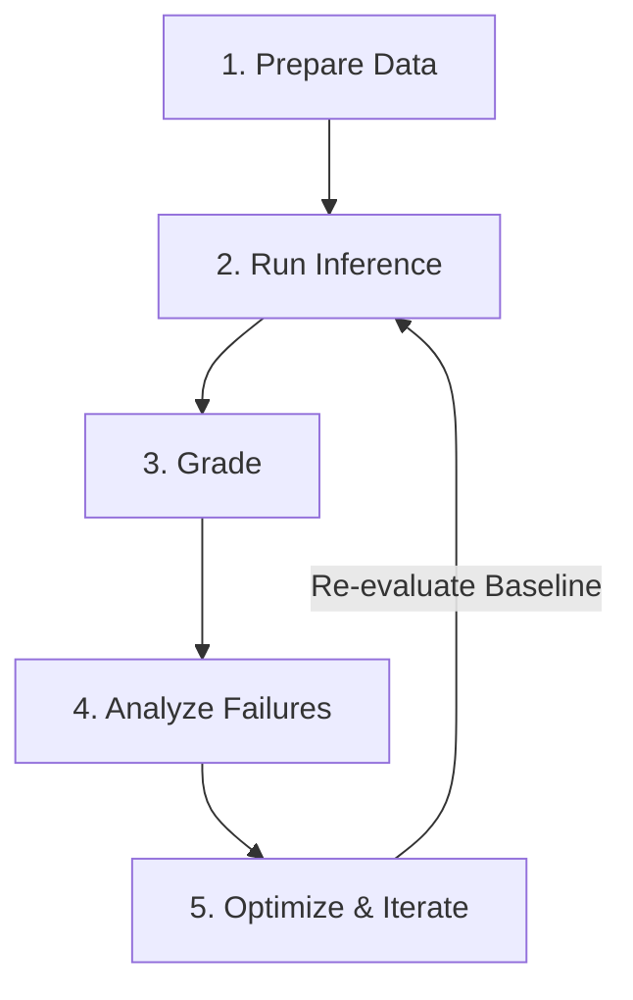

# Agent Quality Flywheel & Evaluation Methodology (`doc/eval.md`)

This document outlines the evaluation framework for Project Benjamin's ADK (Agent Development Kit) multi-agent SRE system, based on the **Agent Quality Flywheel** principles published on the [Google Developers Blog](https://developers.googleblog.com/driving-the-agent-quality-flywheel-from-your-coding-agent/).

---

## 🔁 The 5-Stage Agent Quality Flywheel

Rather than relying on informal "vibe-checks" after prompt changes, Benjamin enforces an automated, repeatable evaluation loop across 5 stages:



1. **Prepare Data**:
   - Synthesize test scenarios via `agents-cli eval dataset synthesize` or extract historical OpenTelemetry (OTel) traces from real GCP incident investigations.
   - Structured JSON configs stored in `eval/configs/*.eval.json` and `eval/scenarios/*.eval.json`.

2. **Run Inference**:
   - Execute ADK SRE agents (`commander`, `ops`, `logistics`, `planning`, `comms`) over test cases to generate multi-turn conversation traces.

3. **Grade**:
   - Score traces using adaptive AutoRaters (`multi_turn_task_success`, `multi_turn_trajectory_quality`) or custom categorical rubrics (`sre_root_cause_accuracy`, `risk_assessment_correctness`).
   - Decoupled scoring via Gemini Enterprise Agent Platform GenAI Evaluation Service ensures optimizers never grade their own work.

4. **Analyze Failures**:
   - Extract rubric verdicts to pinpoint exact step failures (e.g. agent stored correct internal state but echoed stale value in response).
   - Perform Automatic Loss Analysis across failure clusters.

5. **Optimize & Iterate**:
   - Apply targeted prompt or routing fixes, re-run grading, and compare metric deltas against baseline scores.

---

## 📐 Evaluation Strategy: Isolation vs. Integration

When designing evaluation test cases, use this decision framework:

| Evaluation Type | Target Location | What is Tested? | When to Use? |
|---|---|---|---|
| **Single-Agent Isolation** | `eval/configs/*.eval.json` | Individual LLM prompts, tool execution accuracy, output parsing for **one specific role**. | Use when tweaking prompt instructions for a single lead (e.g. Madhavi/Comms, Ops Lead) or testing specific tool calls. |
| **End-to-End Investigation** | `eval/scenarios/*.eval.json` | Multi-turn collaboration, IMAG ICS role handoffs, state transitions, and overall incident resolution. | Use when reproducing a **real production outage / failure mode** involving multiple leads acting sequentially. |

---

## 🎓 Tutorial for Riccardo & Madhavi: Converting a Failure Mode to an Eval JSON

Follow this 4-step tutorial whenever you encounter a new production outage or agent failure mode:

### Step 1: Document the Failure Mode
Identify what went wrong in the real incident or simulation:
- *Example Outage*: A frontend latency spike occurred because a Cloud SQL connection pool hit 100% saturation.
- *Failure Mode to Guard Against*: Ops Lead skipped log analysis and recommended restarting the frontend pods instead of the DB connection pool.

### Step 2: Define Initial Alert & Expected Outcome
Specify the incoming alert payload and what state the incident should reach when resolved:
- `target_project`: `"sre-next"`
- `expected_outcome`: `"CLOSED"`

### Step 3: Map the Hand-Off Steps & Tool Assertions
Break down the ideal step-by-step resolution trajectory into structured JSON step objects:

```json
{
  "scenario_id": "my_new_outage_scenario",
  "name": "Cloud SQL Connection Pool Exhaustion Investigation",
  "target_project": "sre-next",
  "initial_alert": {
    "alert_id": "ALT-12345",
    "metric": "cloudsql.googleapis.com/database/threads_connected",
    "threshold_ms": 100,
    "severity": "CRITICAL"
  },
  "steps": [
    {
      "step_number": 1,
      "agent": "commander",
      "action": "declare_incident",
      "expected_tool": "create_incident_record",
      "expected_state": "ACTIVE"
    },
    {
      "step_number": 2,
      "agent": "ops",
      "action": "query_diagnostics",
      "expected_tools": ["query_metrics", "query_logs"],
      "expected_root_cause": "connection_pool_starvation"
    },
    {
      "step_number": 3,
      "agent": "logistics",
      "action": "evaluate_risk",
      "expected_risk_score": "MEDIUM",
      "expected_decision": "APPROVED"
    },
    {
      "step_number": 4,
      "agent": "commander",
      "action": "close_incident",
      "expected_outcome": "CLOSED"
    }
  ],
  "autorater_rubric": {
    "tool_call_correctness": 1.0,
    "multi_turn_trajectory_quality": 0.95,
    "max_duration_seconds": 60
  },
  "expected_outcome": "CLOSED"
}
```

### Step 4: Save & Run Verification
1. Save your file in `eval/scenarios/<your_scenario_name>.eval.json`.
2. Run `just eval` to verify that the scenario passes cleanly.
3. Export results to an output folder: `uv run python3 -m eval.runner --output-dir out/$(date +%Y%m%d-%H%M)-eval`.

---

## 🛠️ Running Local Evaluations (`just eval`)

Run both single-agent isolation evaluations and end-to-end incident integration scenarios with a single command:

```bash
just eval
```

---

## 🔗 Related Resources

- [User Manual](./USER_MANUAL.md)
- [Action Items for Riccardo](../TODO_RICC.md)
